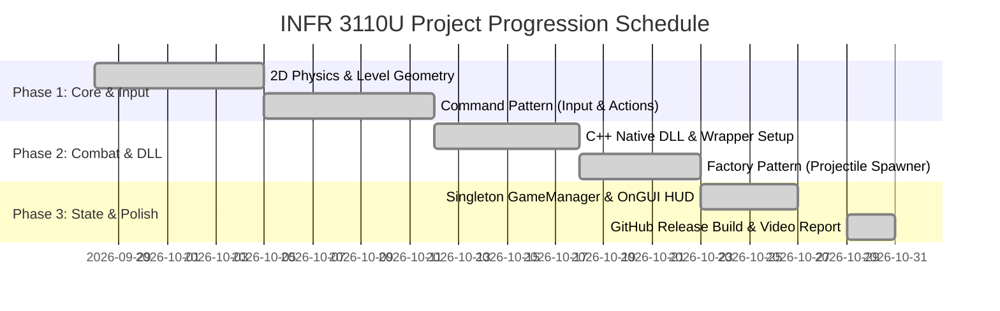
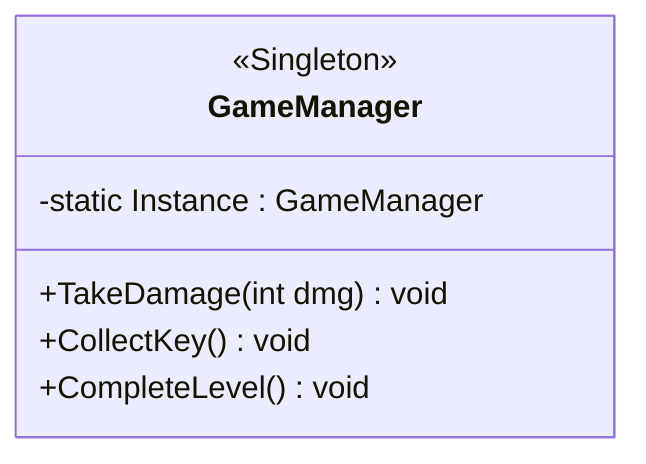
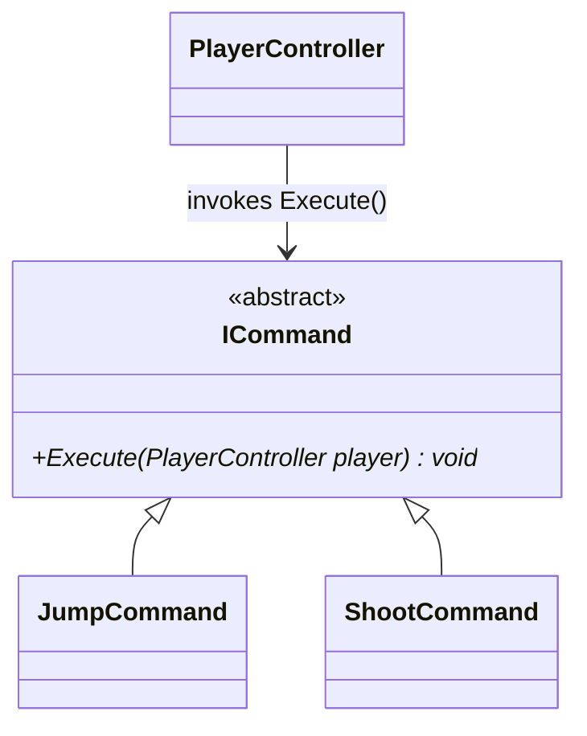
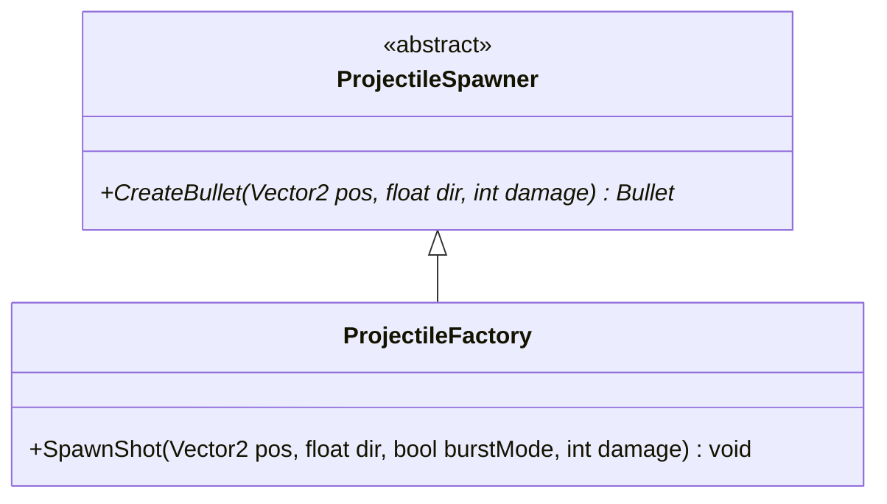
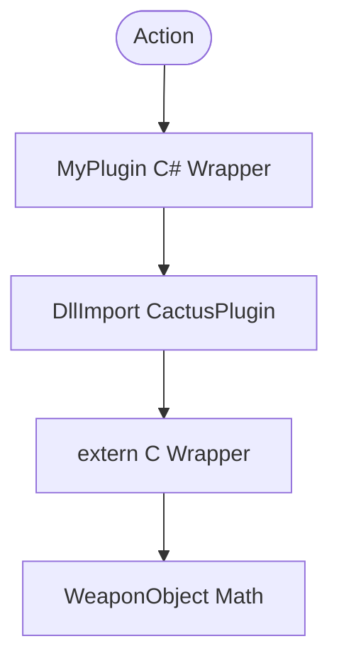

# INFR 3110U - Game Engine Design & Implementation: Project Progression
**Project Title:** Cactus McCoy 2D Action-Platformer Prototype  
**Engine:** Unity 6 (2D Built-In Render Pipeline) & Visual Studio 2022 (C++ x64 Native DLL)

---

## 1. Group Formation & Contributions
* **Name:** Jarell Igene (Student ID: 100980195)
* **Role:** Lead Engine Programmer, Systems Architect, & Level Designer
* **Contribution Percentage:** 100%
* **Declaration:** I, Jarell Igene, confirm that I completed 100% of the code implementation, native C++ DLL development, Unity scene design, and documentation for this submission.

### Strategy & Roles
To maximize development efficiency, I structured this project as an individual vertical slice aligned with my GDW portfolio assignment. My strategy divided the workload into three phases: (1) core physics and Command input, (2) Factory projectile spawning and C++ DLL integration, and (3) Singleton state management. I acted as the sole programmer and designer, utilizing GitHub for version control and modular pattern implementation.

### Gantt Chart

---

## 2. Interactive Media Scenario
The interactive scenario is a 2D side-scrolling action-platformer prototype. The purpose is to provide a combat and traversal testbed demonstrating modular engine architecture. The player must navigate platforms, avoid a fatal hazard pit, defeat patrolling enemies using single or burst fire, collect a gold key, and reach the locked exit door. Core mechanics include 2D rigidbody movement, impulse jumping, shooting, and toggling fire modes (which scales damage via the C++ DLL). The game ends when the player unlocks the door (Victory) or loses all HP (Game Over).

*(Note: See repository root for `SceneAnnotated.png` outlining the Player, Enemies, Bullet, Key, Door, and Hazard)*

---

## 3. Singleton Design Pattern

* **Implementation:** `GameManager.cs` uses a `public static GameManager Instance` initialized in `Awake()`. It tracks global session state (`playerHealth`, `hasKey`, `isGameOver`) and renders the `OnGUI()` HUD.
* **Justification & Benefit:** Centralizing session state keeps objective triggers (Key, Door, Hazard) from needing expensive `FindObjectOfType` calls, while keeping weapon logic decoupled in the Player/Factory to avoid a monolithic "God object".

---

## 4. Command Design Pattern

* **Implementation:** An abstract `ICommand` base class defines `Execute(PlayerController player)`. Concrete classes (`JumpCommand`, `ShootCommand`, `SwitchFireModeCommand`) encapsulate the actions.
* **Justification & Benefit:** Encapsulating player actions decouples input polling from physics/combat logic, adhering to the Single Responsibility principle and allowing for future input remapping or replay logging.

---

## 5. Factory Design Pattern

* **Implementation:** The abstract creator `ProjectileSpawner` declares `CreateBullet()`. The concrete `ProjectileFactory` overrides this to instantiate the prefab, configure DLL-calculated damage, and handle 3-round burst coroutines.
* **Justification & Benefit:** Separating projectile instantiation from the Player ensures the spawner strictly handles object creation, keeping bullet logic independent of the global game state.

---

## 6. Native C++ Plugin / DLL

* **Implementation:** Built as an x64 DLL (`CactusPlugin.dll`) using the two-wrapper architecture taught in lecture: a C++ `WeaponObject` wrapped by C-linkage `extern "C"` functions, which is then imported into Unity via a static C# `MyPlugin` wrapper using `[DllImport]`.
* **Justification & Benefit:** Offloading weapon damage math to a native C++ binary demonstrates cross-language marshaling and allows combat balance tuning by swapping the `.dll` without recompiling the Unity executable.

---

## 7. References
* Baron, D. (2021). *Game Development Patterns with Unity 2021* (2nd ed.). Packt Publishing.
* Nystrom, R. (2014). *Game Programming Patterns*. Genever Benning.
* Unity Technologies. (2026). *Native Plug-ins*. Unity Manual.
* Vine, M. (2026). *INFR 3110U Lectures 03 & 06*. Ontario Tech University.
